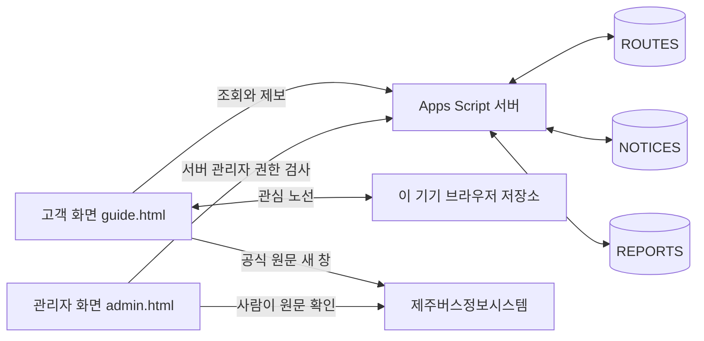

# 04 · 아키텍처

상태: 신규 제안. Apps Script 코드가 없으므로 아래 파일명·함수명·requireAdmin_ 사용은 모두 구현 예정입니다.

## MVP 연결 그림

화면의 서버 호출 통로는 google.script.run을 사용하는 설계입니다. MVP에서는 공식 자료를 사람이 확인·입력하고 고객은 원문 링크를 엽니다. 서버가 공식 웹사이트를 자동 수집하지 않습니다. 위 그림에는 아직 연결하지 않은 외부 API·AI를 넣지 않았습니다.

## 함수 목록 — 모두 예정

| 호출 주체 | 함수 | 하는 일 | requireAdmin_ 계획 | 읽기 | 쓰기 |
| --- | --- | --- | --- | --- | --- |
| 고객 | searchRoutes(query) | 공개 노선 검색·방향 카드 반환 | 없음 | ROUTES | 없음 |
| 고객 | getRouteDetail(route_id) | 공개 노선·유효 안내·검토된 제보의 공개 필드 반환 | 없음 | ROUTES, NOTICES, REPORTS | 없음 |
| 고객 | submitReport(payload) | 입력·요청키 검증, 중복 방지 후 접수 | 없음 | ROUTES, REPORTS | REPORTS |
| 관리자 | getAdminData() | 관리 목록 조회 | 함수 진입 시 필수 | ROUTES, NOTICES, REPORTS | 없음 |
| 관리자 | saveRoute(payload) | 노선 초안 저장·수정 | 함수 진입 시 필수 | ROUTES | ROUTES |
| 관리자 | saveNotice(payload) | 안내 초안 저장·수정 | 함수 진입 시 필수 | ROUTES, NOTICES | NOTICES |
| 관리자 | reviewReport(payload) | 검증·검토메모·공개용 요약 저장 | 함수 진입 시 필수 | REPORTS | REPORTS |
| 관리자 | setPublication(entity,id,status) | 허용 탭·상태·공개 조건 검증 | 함수 진입 시 필수 | ROUTES, NOTICES, REPORTS | 지정된 해당 탭 |

추가 진입점 doGet(e)는 고객/관리 화면을 분기합니다. requireAdmin_은 내부 보조 함수이며 관리 페이지 제공 시와 모든 관리 함수 진입 시 권한을 검사합니다. entity는 고정 허용 목록만 받고 임의 시트명·범위를 받지 않습니다.

클라이언트에서만 처리: 관심 노선 저장·해제, 제보 창 열기·닫기, 공식 링크 열기. 이런 버튼에는 서버 함수가 필요하지 않습니다.

## 관리자 인증과 공개 경계

- 별도 관리 주소는 화면 분기 수단이며 인증 수단이 아닙니다.
- Apps Script 배포의 실행 주체·접근 허용 설정에 따라 사용자 식별 가능 여부가 다릅니다. 현재 미검증입니다. 인증 방식을 확정하지 못하면 관리 화면을 공개 배포하지 않고 소유자 시트 편집으로 운영합니다.
- requireAdmin_은 검증된 로그인 주체를 허용 목록과 비교하고, 주체를 확인할 수 없으면 차단해야 합니다. 고객이 보낸 isAdmin 값은 신뢰하지 않습니다.
- 키·시트 ID·관리자 설정 값의 위치는 ‘스크립트 속성’으로만 기록합니다. 실제 값은 문서·고객 응답·로그에 넣지 않습니다.
- 공개 응답은 필요한 필드만 선택합니다. 관리 메모와 제보 원문이 숨김 처리만 된 채 전송되지 않도록 합니다.

## 운영과 실패 처리

공식 확인 → 초안 입력 → 방향·시행일·원문 대조 → 공개 → 기간 만료·재확인. 원문 게시일이 최신이어도 시행일이 과거일 수 있습니다. 상충하는 정보는 conflict로 두고 공개하지 않습니다. 네트워크 실패 시 성공·정상 운행으로 표시하지 않습니다.

## 후속 확장 경계

AI 초안과 도착정보 API는 현재 연결하지 않습니다. 05는 후속 설계입니다. 제공 API의 제주 지역·방향별 식별자·갱신 시각·캐시 조건·비용과 무료 한도를 확인한 뒤 범위를 정합니다. [TAGO 공식 Open API 안내](https://tago.go.kr/v5/use/openapi.jsp)는 후보 조사 출발점일 뿐, 제주 전 노선 지원이나 무료 호출 가능성을 검증한 근거는 아닙니다.

비용이 발생하거나 불명확한 API·AI·호스팅·자동 발송 작업은 공급자, 목적, 과금 기준, 예상 비용, 기간, 무료 한도·초과·갱신 조건을 설명하고 사용자의 명시적 승인을 받은 뒤 진행합니다.
