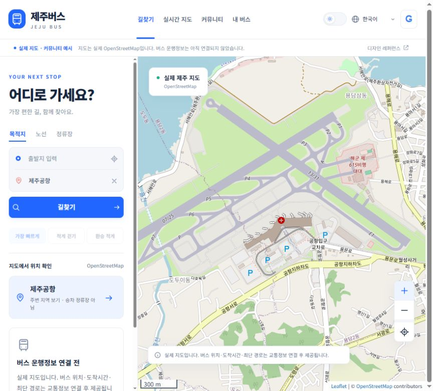
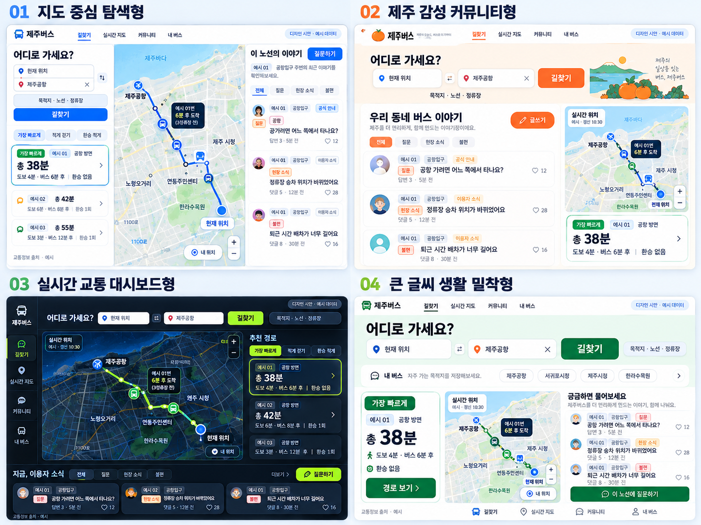
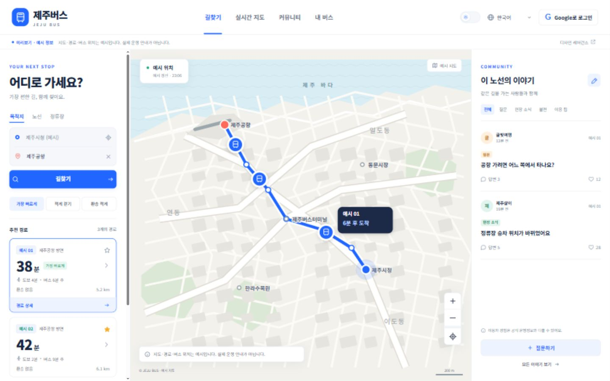
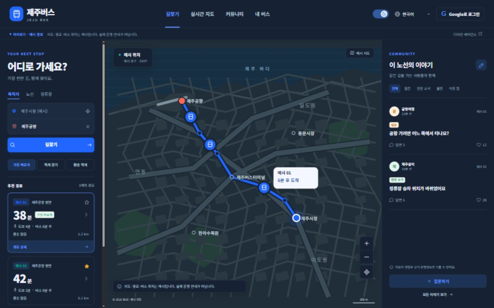

# 08 · 제주버스 개발 착수 — 지도 중심 탐색형

작성일: 2026-10-23 (Asia/Seoul)

## 2026-10-24 갱신

현재 구현 및 실연동 검증 상태는 [09 · API 발급과 실연동 검증](09_API발급과_실연동_검증.md)을 우선한다. 실제 지도 지점 선택, 공급자 기반 검색·시간/거리/도보/환승 정렬·버스 위치/도착 어댑터, Google OAuth, 커뮤니티 수정/삭제/신고/차단/관리자 기능, 로컬 API 설정 화면을 추가했다. 현재 15개 자동 테스트 그룹과 19개 JS 파일 구문 검사가 통과했다. 실제 외부 계정·API 키 발급과 제주 운행 응답/Google 로그인 검증은 남아 있다. 아래 ‘첫 구현’ 등은 개발 이력이다.

## 실제 지도 수정 — 현재 상태

사용자 피드백을 반영해 자체 SVG 예시 지도를 **Leaflet 1.9.4 + 실제 OpenStreetMap 타일 지도**로 교체했다. 아래 ‘첫 구현’과 캡처는 교체 이전 이력이다. 현재 상태는 이 절을 우선한다.

- 실제 제주 지도를 이동·확대/축소하고, 장소 선택 시 해당 주변 지도로 이동한다. 지도 중심 좌표는 주변 지역 표시용이며 버스 정류소·승차 위치가 아니다.
- 현재 위치 버튼은 사용자가 위치 접근을 허용한 경우에만 실제 기기 좌표와 정확도 반경을 지도에 표시한다. 좌표는 서버/DB에 저장하지 않는다.
- 임의로 그린 노선 선·버스 위치·새로 갱신된 것처럼 보이던 예시 시각을 제거했다.
- ‘38분’, ‘6분 후 도착’ 등 예시 시간과 정렬을 기본 결과에서 제거/비활성화했다. 실제 교통정보 연결 전에는 버스 위치·도착시간·최단경로를 제공하지 않는다고 표시한다. `/api/status`는 `mapMode=openstreetmap`, `journeyMode=unavailable`을 반환한다.
- 공개 지도 타일만 브라우저에서 현재 보이는 영역에 요청한다. 출처를 표시하고 브라우저 기본 캐시와 Referer를 유지한다. 오프라인 저장·대량 다운로드·사전 수집은 구현하지 않는다. 계정·결제수단·유료 요금제·자동 과금은 연결하지 않았다. 보장형 운영 SLA가 필요한 배포 단계에는 지도 공급자를 다시 평가한다.
- Leaflet 버전을 고정하고 JS/CSS·라이선스를 `web/public/vendor/leaflet/`에 보관했다. 지도 라이브러리 로딩에 외부 CDN을 사용하지 않는다. `package-lock.json` 추가.
- 테마는 앱 UI에 적용한다. 실제 OSM 기본 지도는 원본 색상을 유지하며, 지도 글자를 임의로 번역하거나 지리정보를 꾸며내지 않는다.
- 브라우저에서 실제 `https://tile.openstreetmap.org/14/...png` 타일 16개가 정상 로드됨(`naturalWidth > 0`)과 기존 SVG 지도 제거를 확인했다.

정책: [OSM 타일 이용 정책](https://operations.osmfoundation.org/policies/tiles/), [출처·라이선스](https://www.openstreetmap.org/copyright), [Leaflet 공식 문서](https://leafletjs.com/examples/quick-start/).

실제 버스 위치·도착정보·목적지 기반 최단경로와 실제 Google 로그인의 외부 설정은 **미완료**다. 지도 교체를 앱 전체 완성으로 기록하지 않는다.

수정 후 실제 화면:



수정 검증: 자동 테스트 7개 그룹 통과, 구문 검사 통과. 사용자가 보고 있던 localhost 탭을 새로고침했으며 실제 지도 확대 후 z=15 타일 12개 정상 로드, 예시 SVG 없음, 화면의 ‘38분/6분 후 도착’ 제거를 확인했다.

## 확정한 방향

사용자가 선택한 **01 지도 중심 탐색형**을 기준으로 개발한다. 목적지·노선·정류장 검색, 버스 위치 지도, 노선별 커뮤니티가 하나의 사용 흐름으로 연결되는 웹앱이다. 추가 요구사항은 **Google 로그인**, **다크/라이트 모드 토글 스위치**, **한국어·영어·중국어·일본어**다. 중국어는 우선 간체(`zh-CN`)로 구현한다.

01~07은 이전의 ‘노선 변경 안내 중심 MVP / Apps Script’ 기획 기록이다. 회원가입·댓글·길찾기·실시간 정보를 제외했던 이전 범위는 이번 사용자 지시로 확장됐다. 현재 개발 범위와 구현 상태는 이 문서를 우선한다. 이전 기획에 적힌 관리자·시트·AI 기능이 구현됐다는 뜻은 아니다.

## 디자인 레퍼런스

아래 합성 이미지의 **왼쪽 위 01 지도 중심 탐색형**이 선택된 레퍼런스다. 나머지 3개는 비교용으로 보존한다.



레퍼런스 원본: `assets/제주버스_4가지시안_지도중심형선택.png`  
앱 안의 ‘디자인 레퍼런스’ 버튼으로도 원본을 볼 수 있다.

### 화면 원칙

- 데스크톱: 상단 브랜드·메뉴·테마·언어·Google 로그인. 본문은 **왼쪽 검색/경로 카드 → 중앙 지도 → 오른쪽 관련 커뮤니티**.
- 기본 색상은 블루 `#2167ff`, 흰 패널, 얇은 회색 경계. 다크 모드는 모든 패널·지도·폼·팝업까지 색상 토큰으로 전환.
- 761~1020px에서는 검색과 지도를 표시하고 커뮤니티 메뉴로 글을 확인한다. 760px 이하에서는 하단 메뉴로 검색·지도·커뮤니티·내 버스를 전환한다. 첫 화면은 검색이다.
- 검색 결과에는 버스번호·방향·총 예상시간·도보·대기·환승 수를 함께 표시한다.
- 커뮤니티 글은 노선에 연결한다. 질문, 현장 소식, 불편, 이용 팁을 구분한다. 예시 글과 공식 운행정보를 혼동시키지 않는다.
- 제보·질문·답변과 공식 안내의 출처를 구분하고 실제 운행정보에는 공급자·마지막 수신 시각을 표시한다.

## 첫 구현

앱 위치: `../web/`. 별도 패키지 설치 없이 현재 설치된 Node.js 22.21.0으로 실행한다. 프런트엔드는 HTML/CSS/JavaScript 모듈, 서버는 Node.js HTTP, 저장소는 내장 SQLite다. SQLite는 현재 Node 22에서 실험적 경고가 나타난다.

| 항목 | 현재 상태 |
| --- | --- |
| 레퍼런스 이미지와 3열 화면 | 구현 |
| 목적지·노선·정류장 검색 | **제한된 예시 데이터로 구현**. 임의 목적지의 실제 길찾기는 아직 아님 |
| 최단시간·도보 적게·환승 적게 정렬 | 예시 경로 지표에 따라 정렬. 총시간=도보+대기+탑승 |
| 버스 위치·정류장·노선 지도 | 자체 SVG 예시 지도, 경로 선택·버스 선택·확대/축소 구현. 실제 지리·실시간 위치 아님 |
| 관심 노선 | 브라우저 localStorage에 저장·해제, ‘내 버스’에서 조회 |
| 커뮤니티 | 노선·분류 필터, 상세·답변 조회, 로그인 후 글·답변·도움 됐어요 API와 SQLite 저장 구현 |
| Google 로그인 | OAuth 서버 흐름·콜백·검증·세션·로그아웃 구현. **실제 클라이언트 설정과 계정 로그인 검증 대기** |
| 다크/라이트 | 실제 토글 스위치와 저장 구현. 최초에는 시스템 테마 반영 |
| 다국어 | `ko`, `en`, `zh`(간체), `ja`. UI·폼·메시지·예시 글·지도 라벨 번역. 선택 저장 |
| 실제 이용자 작성 글 번역 | 원문 그대로 표시. 자동 번역·AI API는 아직 연결하지 않음 |
| TAGO 도착정보 | 선택적 서버 어댑터 `/api/arrivals` 구현 및 모의 응답 테스트. **실제 키·도시/정류소 검증·화면 연결 대기** |
| 실제 실시간 버스 위치 / 실제 최적 경로 | 공급자 선정·키·응답 검증 후 연결할 후속 작업 |
| AI 자연어 검색 | 후속. 검증된 경로 결과를 조건별로 선택·설명하는 역할 |
| 외부 배포 | 미실시. 현재 로컬 개발본 |

### 주요 파일

```text
web/
  package.json                 실행·테스트 명령 (외부 의존성 없음)
  .env.example                 로컬 설정 예시, 실제 값 없음
  server.mjs                   정적 파일/API/OAuth 라우터
  lib/auth.mjs                 Google state·PKCE·ID token 서명/클레임 검증
  lib/store.mjs                SQLite 사용자·세션·게시물·답변·반응
  lib/transit.mjs              선택적 TAGO 도착정보 어댑터
  public/index.html            앱 진입점
  public/app.js                화면·검색·커뮤니티·테마·언어 상호작용
  public/styles.css            반응형 화면 / 라이트·다크 디자인 토큰
  public/i18n.js               한국어·영어·중국어·일본어 사전
  public/map.js                예시 지도 렌더러
  public/data.js               명시적인 예시 정류장·경로·커뮤니티 글
  public/design-reference.png  사용자가 선택한 레퍼런스 원본
  test/app.test.mjs            네트워크 과금 없는 로컬 자동 테스트
  data/jejubus.sqlite          최초 실행 시 생성, Git 제외
```

## 로컬 실행

프로젝트 루트에서:

```powershell
cd web
npm run dev
```

브라우저: <http://localhost:3000>

테스트:

```powershell
npm test
npm run check
```

포트 변경 시 `.env`의 `PORT`와 `APP_ORIGIN`, Google의 리디렉션 URI를 함께 맞춘다. 서버는 기본적으로 `127.0.0.1`에만 바인딩한다. `localhost:3000`이 아닌 다른 Host 헤더는 거절한다.

예시 검색: 제주공항 / Jeju Airport / 济州机场 / 済州空港, 동문시장, 제주버스터미널, 한라수목원. 예시 노선: `01`, `02`, `03`. 검색 가능한 샘플 밖의 장소는 결과 없음으로 안내한다. 미리보기 출발지는 제주시청이다. 실제 위치를 확인해도 예시 경로를 실제 위치 기반 결과라고 표시하지 않는다.

## Google 로그인 연결

1. 사용할 Google Cloud 프로젝트의 OAuth 웹 클라이언트를 확인한다. 신규 계정·프로젝트·요금 활성화가 필요하면 먼저 비용 조건을 확인한다.
2. Google 인증 화면의 앱 이름·대상 사용자를 설정하고, 테스트 상태라면 테스트 사용자를 등록한다.
3. 승인된 리디렉션 URI를 정확히 `http://localhost:3000/auth/google/callback`으로 등록한다.
4. `web/.env.example`을 `web/.env`로 복사하고 **로컬 파일에만** `GOOGLE_CLIENT_ID`, `GOOGLE_CLIENT_SECRET`을 입력한다. 비밀키를 채팅·스크린샷·public 폴더·Git에 넣지 않는다.
5. 서버를 재시작하고 Google로 실제 로그인 → 세션 생성 → 게시글/답변 → 로그아웃을 검증한다.

흐름: Google authorization code + state + nonce + PKCE(S256) → 서버 토큰 교환 → Google 공개키로 RS256 서명과 issuer/audience/expiry/nonce 검증 → 내부 세션 발급. 사용자 식별자는 변경 가능한 이메일 대신 Google `sub`를 사용한다. Google access/refresh token은 DB나 브라우저 저장소에 저장하지 않는다. 로컬 세션은 토큰 해시로 저장하며 HttpOnly·SameSite=Lax 쿠키를 사용하고 HTTPS에서는 Secure를 추가한다. 세션 유효기간은 7일이다. 로그아웃하면 서버 세션도 폐기한다.

현재 클라이언트 설정이 없으면 로그인 연결 대기 안내를 띄운다. 가짜 로그인이나 인증 우회용 공개 엔드포인트는 만들지 않는다. 읽기는 비로그인 허용, 글·답변·반응은 서버에서 로그인 여부를 검사한다.

공식 참고: [Google OpenID Connect](https://developers.google.com/identity/openid-connect/openid-connect)

## 교통정보 연결 순서

1. **제주 BIS**: 제주 노선·방향·정류소 ID와 버스 위치 데이터 제공 경로·호출 한도를 확인한다. [공식 데이터 등록](https://www.data.go.kr/data/15058442/openapi.do)
2. **TAGO**: 도시코드 목록과 실제 제주 정류소 응답을 확인한다. 키는 서버에 보관한다. 어댑터는 15초 캐시·요청 시간제한을 적용하고 실패 시 예시값으로 대체하지 않는다. [버스도착정보 명세](https://www.data.go.kr/data/15098530/openapi.do)
3. **길찾기 공급자**: ODsay 등 유·무료 서비스를 제주 경로 품질, 도보 접근·대기시간 반영, 계약·호출 한도로 비교한다. [ODsay 공식 문서](https://lab.odsay.com/guide/releaseReference), [요금](https://lab.odsay.com/contact/contact)
4. 실제 지도·노선·정류소·차량 ID를 연결하고 각 상태를 `live / stale / unavailable`로 구분한다. 버스 위치와 도착예정시각은 별개 데이터다.
5. 실제 경로 엔진 연결 후 목적지 검색을 확장한다. 단순 직선거리를 걸리는 시간·도보거리로 오인하지 않는다. AI는 검색 의도 해석과 검증된 결과 설명에 사용한다.

TAGO 어댑터를 켤 때는 `TRANSIT_MODE=tago`, `TAGO_SERVICE_KEY`, `TAGO_CITY_CODE`, `TAGO_STOP_ID`가 모두 필요하다. ServiceKey에는 포털의 **일반/디코딩 키**를 입력한다. 현재 어댑터는 하나의 검증된 정류소 도착 조회를 위한 연결 지점이며, 예시 경로·지도 전체를 실데이터로 전환하는 설정이 아니다.

무료·유료 모두 검토한다. 실제 비용이 발생·증가하거나 과금 조건이 불확실한 실행 전에는 서비스, 목적, 요금 기준, 예상 비용·예산, 기간, 반복 요금, 무료 한도·초과·자동 갱신 조건을 설명하고 구체적인 승인을 받는다. 무료 서비스를 강제하거나 유료 서비스를 배제하는 요구가 아니다.

## 검증 기록

2026-10-23, Node.js 22.21.0:

- `npm test`: **7개 테스트 그룹 통과**. 4개 언어 키와 치환, 경로 정렬, 비로그인·잘못된 Origin/Host 차단, 게시물·답변·반응, 로그아웃 후 세션 무효화, DB 재시작 영속성, OAuth 서명·audience·nonce·만료·변조 거절, state 바인딩·PKCE·재사용 거절, 교통정보 캐시·실패 처리 포함.
- `npm run check`: JavaScript 구문 검사 통과.
- 외부 OAuth/교통 API 호출 없이 메모리와 임시 로컬 DB·모의 응답으로 테스트했다.
- 실제 Google 계정 로그인, 제주 API 실응답, 실제 최단경로·도착예측 정확도는 아직 검증하지 않았다.
- 브라우저 검증: 1440×900 데스크톱 3열 화면, 390×844 모바일 검색·지도·커뮤니티 탭, 한국어/영어/중국어/일본어 전환, 테마·언어·관심 노선의 새로고침 후 유지, 도보 적게 정렬에 따른 노선 선택 변경, 없는 목적지 결과 없음, 질문 상세와 답변 3개 로딩, Google 설정 미연결 안내를 확인했다. 모바일 가로 넘침 없음(`scrollWidth=clientWidth=390`), 브라우저 오류·경고 로그 없음.

실제 구현 화면:





## 다음 개발 작업

- [ ] 기존 Google OAuth 클라이언트 설정 연결, 실제 로그인/로그아웃·권한 검증.
- [ ] 실제 지도·제주 BIS·도착정보·경로 엔진의 제공 범위·조건 확정 및 연결.
- [ ] 커뮤니티 신고·차단·수정/삭제·관리자 검토, 개인정보 처리방침과 보관·탈퇴 정책.
- [ ] 운영 배포 시 HTTPS·백업·모니터링·접근제어·트래픽·요금 상한 검증. 현재 로컬 SQLite/HTTP 구성을 검토 없이 공개 운영하지 않는다.
- [ ] 번역 원어민 검수, 장소명 검색 별칭, 실제 교통정보 안내의 다국어 매핑.
- [ ] 실제 이동 시나리오로 목적지·방향·도보·환승·긴 배차와 데이터 누락 사례 검증.
