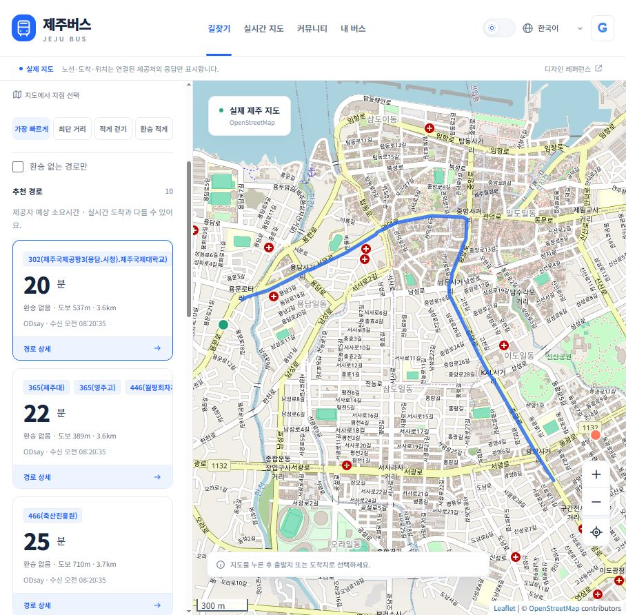
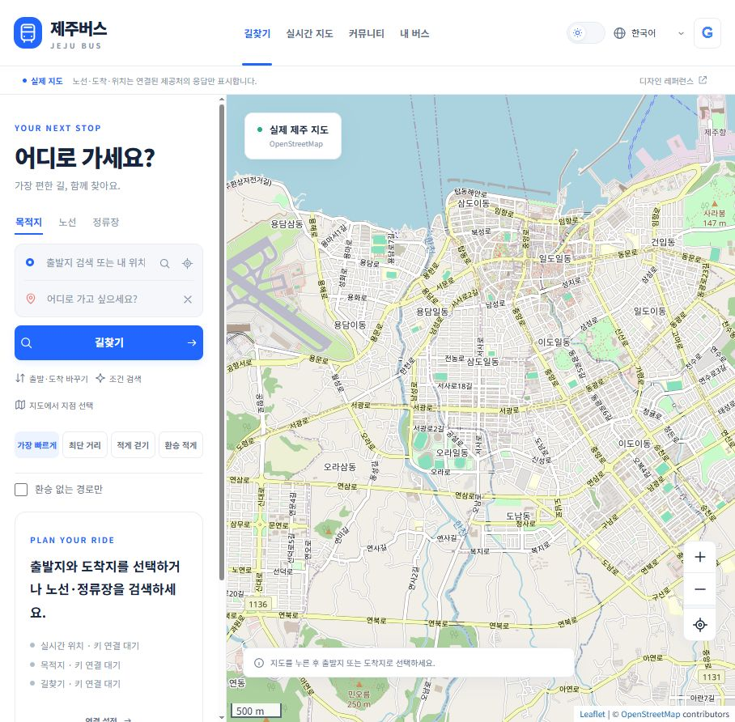

# 09 · API 발급과 실연동 검증

갱신: 2026-10-24 (Asia/Seoul). 현재 앱: http://localhost:3000/ · 로컬 설정: http://localhost:3000/setup

**최신 연결 결과는 [10 환경변수 연결 현황](10_환경변수_연결현황.md)을 기준으로 한다.** TAGO 4종 승인·제주 실응답·카카오 장소/경로·ODsay 실연동 및 Vercel Production Secret 25개 등록 완료. Google 실제 로그인과 Firebase DB·배포는 미완료이며 OpenAI는 키만 저장하고 유료 추론은 비활성이다. 아래 발급 절차는 처음 연결할 때의 참고 가이드다.

## 현재 상태

실제 OpenStreetMap 지도, 지도 지점 선택, 검색·길찾기·실시간 정보용 서버 어댑터와 화면, 커뮤니티 CRUD/답변/공감/신고/차단/관리자 검토, Google OAuth 서버, 테마와 4개 언어 UI를 구현했다. **ODsay Basic 키를 발급해 실제 제주 버스 길찾기 10개 경로와 지도 경로선·승하차 상세·도보 정렬을 브라우저에서 검증했다. 카카오 장소 검색·길찾기와 TAGO 제주 노선·정류소·도착·차량 위치 실제 응답도 검증했다. Google 키는 서버 인식 완료·실제 로그인 미검증이다.** Vercel 환경변수 등록은 완료했고 실제 배포와 Firebase DB 연결은 미완료다. 코드 구현과 모의 응답 검증을 실연동 완료로 취급하지 않는다.

키가 없는 기본 앱에는 임의 버스·경로·도착시간을 표시하지 않는다. 예시 커뮤니티는 기본 비활성이다. 자동 테스트용 서버는 별도 임시 포트·메모리 DB와 `QA` 데이터만 사용하며 실제 API로 나가는 요청을 금지한다.

## 발급 순서

### 1. Google 로그인

1. [Google Auth Platform](https://console.cloud.google.com/auth/clients)에서 제주버스용 프로젝트를 선택한다. 브라우저에 열려 있던 다른 프로젝트의 OAuth 클라이언트는 변경하거나 재사용하지 않았다.
2. 브랜딩에 앱 이름 `제주버스`와 실제 운영자의 지원 이메일을 입력한다. 외부 사용자를 대상으로 테스트 상태로 준비하고 테스트 계정을 등록한다. 회사/개인 정보와 약관 동의는 계정 소유자가 확인한다.
3. 웹 애플리케이션 클라이언트를 생성한다. 승인된 리디렉션 URI는 **정확히** `http://localhost:3000/auth/google/callback`이다. `localhost`와 `127.0.0.1`을 섞지 않는다.
4. 로컬 `/setup`의 Client ID와 Client secret 또는 `web/.env.local`에 입력하고 저장한다. 채팅으로 보내지 않는다. 비밀값은 `web/.env.local`에만 저장되고 응답 API·브라우저 코드·로그로 반환하지 않는다. 설정은 상태 조회 시 재시작 없이 반영된다. 사용자가 입력한 Google ID·secret의 서버 인식은 확인했다.
5. ‘로그인 확인’ 후 계정 이름 표시, 글 작성, 로그아웃 후 권한 해제를 검증한다. 로컬 관리자 계정은 로그인한 후 `/setup`의 관리자 지정 버튼으로 명시적으로 등록한다.

현재 OAuth는 Google의 서명·issuer·audience·만료·nonce를 검증하며 state·브라우저 쿠키·PKCE를 사용한다. Google 액세스/리프레시 토큰을 DB에 저장하지 않는다. 앱 세션은 해시 값만 SQLite에 저장한다. 배포용 URI, 실제 도메인·브랜딩·개인정보처리방침·Google 심사와 운영 사용자 테스트는 배포 전에 별도 완료해야 한다. 유료 Cloud 기능이나 결제 계정은 연결하지 않았다.

공식 문서: [OpenID Connect](https://developers.google.com/identity/openid-connect), [프로젝트와 선택적 결제 설정](https://developers.google.com/workspace/guides/create-project).

### 2. 실시간 버스 · TAGO

공공데이터포털에 로그인한 뒤 다음 **네 서비스 모두** 활용 신청한다.

| 서비스 | 공식 신청 페이지 | 구현한 기능 |
| --- | --- | --- |
| 버스 노선정보 | [15098529](https://www.data.go.kr/data/15098529/openapi.do) | 노선 번호 검색, 경유 정류장·순서·상하행 |
| 버스 정류소정보 | [15098534](https://www.data.go.kr/data/15098534/openapi.do) | 이름·번호 검색, 좌표 반경 내 정류장, 도시 목록 |
| 버스 도착정보 | [15098530](https://www.data.go.kr/data/15098530/openapi.do) | 정류장별 도착 예상 초·남은 정류장 |
| 버스 위치정보 | [15098533](https://www.data.go.kr/data/15098533/openapi.do) | 실제 좌표가 제공된 차량 위치 |

포털은 무료·개발계정 트래픽 10,000·자동승인으로 안내한다. 실제 계정의 승인 상태·운영 조건을 다시 확인한다. 앱은 전체 TAGO 요청을 한국 날짜 기준 1,000회/일 이내로 제한하며 한도를 넘으면 중지한다. 인증키는 **일반 인증키(Decoding)**를 입력한다. 이미 인코딩된 키를 넣지 않는다.

도시 코드는 임의로 가정하지 않는다. 키 저장 후 ‘제주 지원 도시 확인’을 눌러 제공 목록에 제주가 있는지 확인한다. 목록에 없거나 노선·도착·차량 응답이 제공되지 않으면 TAGO만으로 제주 서비스 완료를 선언할 수 없다. [제주 BIS 공개 데이터 안내](https://www.data.go.kr/data/15058442/openapi.do)와 해당 기관에서 공식 제공하는 이용 가능한 연계를 확인해야 한다. 제주 BIS 웹사이트의 미공개 내부 요청을 무단 대체 API로 사용하지 않는다.

### 3. 장소 검색·버스 길찾기 · 카카오

[카카오 앱 관리](https://developers.kakao.com/console/app)에서 사용할 앱을 계정 소유자가 결정한다. **브라우저의 현재 계정에는 이미 다른 앱에 ‘카카오맵 무료 쿼터’가 적용되어 있었다. 제주버스용 새 앱이 무료라는 전제로 생성·활성화하지 않는다. 최신 상태: 사용자의 연결 요청에 따라 기존 펀제주 앱(ID 1432936)의 무료 배지·카카오맵 ON·유료 API 꺼짐을 확인하고 REST 키를 서버에 저장했다. 실제 장소·경로 조회 성공. 기존 앱과 무료 쿼터를 공유하며 유료 전환이나 기존 앱 설정 변경은 하지 않았다.**

- 무료 방식을 선택하려면 기존 무료 앱의 재사용 가능성, 해당 앱 운영에 미치는 영향, 남은 쿼터, 유료 API 꺼짐을 확인해야 한다. 확인 전 `KAKAO_ENABLED=false`다.
- 무료 적용 앱으로 확인되면 REST API 키를 로컬 설정에 입력하고 ‘이 앱의 무료 쿼터와 유료 API 꺼짐을 확인했습니다’를 직접 체크한 후 저장한다. 별도 유료 활성화는 이 체크로 승인되지 않는다.
- 공식 무료 기준은 첫 활성화 앱의 장소 검색 100,000회/일, 대중교통 경로 1,000회/일이며 월간 쿼터도 별도 적용된다. 계정 및 다른 앱의 사용량을 이 로컬 앱이 모두 확인할 수는 없다.
- 이 앱의 제한은 장소 100회/일, 경로 100회/일이다. 캐시와 동시 요청 중복 제거로 불필요한 호출을 줄인다.
- 유료 별도 앱을 원하면 공식 단가 기준 장소 2원/건, 대중교통 경로 10원/건이다. 예를 들어 장소 검색 2회와 길찾기 1회는 단가 합계 14원이다. 현재 앱 제한으로 계산한 30일 최대 단가 합계는 36,000원이다. 이는 과금 승인이 아니며 세금·비즈월렛 결제/충전·실제 계정 조건은 활성화 전에 확인해야 한다. 무료 한도 초과나 두 번째 앱의 호출은 유료 사용 설정이 필요하며, 해당 조건·예산·기간에 대한 사용자 승인 전 실행하지 않는다.

공식 근거: [이용 정책·첫 활성화 앱 무료 조건](https://developers.kakao.com/docs/ko/kakaomap/common), [무료 쿼터와 사용 단가](https://developers.kakao.com/docs/ko/getting-started/quota), [유료 API 설정](https://developers.kakao.com/docs/ko/app-setting/paid-api), [장소·대중교통 경로 REST 명세](https://developers.kakao.com/docs/ko/kakaomap/rest-api).

### 4. ODsay 대체 경로 · 선택

[ODsay Lab](https://lab.odsay.com/)의 Basic 무료 대상 조건과 무료 제공량을 확인한 경우 사용할 수 있다. 공개 안내는 Basic 30회/일이다. 앱은 경로 및 선형 요청을 합쳐 25회/일로 제한한다. 공급자 콘솔에서 서버 요청의 허용 도메인/IP를 안내대로 등록한다. 운영 환경에서 실제 허용 방식은 별도 확인해야 한다.

2026-10-24 사용자 승인 후 `jejubus` Basic 애플리케이션 등록 완료. 콘솔에서 0원·30회/일·기간 무제한·활성 상태를 확인했다. 허용 URI는 `localhost:3000`이며, 서버의 Referer 인증으로 실제 조회에 성공했다. `ODSAY_API_KEY`, `ODSAY_ENABLED=true`, `ODSAY_DAILY_LIMIT=25`를 `web/.env.local`에 저장했다. 키는 서버 전용이며 Git에서 제외된다. 결제 수단과 유료 Flex는 설정하지 않았다. Vercel의 실제 서비스 도메인은 배포 설정 확정 후 허용 URI와 환경변수에 추가해야 한다.

실제 제주공항 인근→제주시청 인근 API 조회에서 버스 경로 10개를 받았다. 브라우저 지도 지점 선택→길찾기→도로 경로선→승하차 상세를 확인했으며, 도보 적게 정렬에서 도보 103m 경로가 먼저 표시됐다. 소요시간은 공급자의 예상치이며 실시간 차량 도착시간이 아니다. `loadLane` 요청에는 공식 명세의 좌표 기준 `0:0@`를 붙이며 검색·선형 호출에 동일한 일일 예산을 적용한다.

ODsay는 카카오가 구성되지 않았을 때 선택할 수 있는 대체 공급자다. 카카오 요청 실패·쿼터 초과 시 자동으로 다른 공급자나 유료 플랜으로 전환하지 않는다. Flex 공개 단가는 25원/호출, 부가세 별도이고 카드 등록 후 후불 결제 조건이므로 사전 승인 없이 설정하거나 호출하지 않는다. 무료 대상 조건을 만족하지 않는 경우에도 임의 실행하지 않는다.

공식 근거: [명세](https://lab.odsay.com/guide/releaseReference), [플랜 안내](https://lab.odsay.com/contact/contact).

### 5. AI 자연어 조건 해석 · 별도 비용 승인 필요

화면의 ‘조건 검색’은 현재 규칙 기반이다. 한국어·영어·중국어·일본어의 목적지와 빠르게/최단거리/적게 걷기/환승 적게 조건을 추출하며 AI라고 표시하지 않는다. 임의 문장을 완벽히 이해하는 LLM으로 설명하지 않는다.

선택적 OpenAI Responses 어댑터 코드는 준비했고 사용자의 요청으로 다른 로컬 프로젝트의 기존 API 키를 서버 환경변수에 저장했다. 기본 모델은 지정하지 않았고 유료 추론 호출은 하지 않았다. 활성화에는 `OPENAI_API_KEY`, 명시적 모델, `AI_ENABLED=true`, `AI_BILLING_APPROVED=true`가 모두 필요하다. 공급자·선택 모델의 최신 입력/출력 토큰 단가·예상 사용량·승인 예산·사용 기간을 제시해 승인받은 후에만 설정한다. 현재는 별도 비용 승인이 없으므로 비활성으로 유지한다. AI는 목적지/조건 해석만 하며 경로·시간·도착정보를 생성하지 않는다. 실제 계산은 교통 공급자 데이터만 사용한다.

공식 명세: [OpenAI Structured Outputs](https://developers.openai.com/api/docs/guides/structured-outputs). 요청은 `store:false`, 출력 상한 300토큰이며 모델·일일 요청 수 제한은 금액 상한을 대신하지 않는다.

## 사용자 기능과 검증 범위

| 기능 | 현재 구현 | 실서비스 검증 |
| --- | --- | --- |
| 실제 지도·확대·이동·지도 지점 선택 | 실제 OSM 타일, 출발/도착 선택 | 실제 브라우저에서 확인 |
| 현재 위치 | 사용자 허용 후 좌표/정확도 표시 | 실제 기기의 위치 접근 허용은 사용자 확인 필요 |
| 노선·정류장·장소 검색 | 공급자 검색, 결과 선택, 더 보기, 근처 정류장 거리 정렬 | TAGO·카카오 키 저장 및 실제 제주 응답 확인 |
| 버스 길찾기 | 카카오/선택 ODsay 정규화, 시간·총거리·도보·환승 정렬, 직행 필터, 상세 | ODsay Basic 실제 제주 경로 10개·지도 경로선·승하차 상세·도보 정렬 확인. 카카오 미검증 |
| 노선·차량 지도 표시 | 정류장 점/공식 좌표의 차량만 표시, 도로 선형은 공급자 좌표가 있을 때만 표시 | TAGO 실제 차량 4대 응답·지도 표시 확인 |
| 실시간 갱신 | 선택한 노선/정류장만 20초 간격, 숨긴 문서·커뮤니티·내 버스에서는 자동 호출 중지, 오류 시 마지막 수신 정보 명시 | 모의 응답/오류·캐시/할당량 테스트 |
| 관심 노선 | 실제 검색한 노선 메타데이터를 브라우저에 저장 | 브라우저에서 저장·내 버스 확인 |
| Google OAuth | 서버 검증·PKCE·state·nonce·해시 세션 | 서명 토큰 및 OAuth 모의 테스트. 실제 사용자 로그인 미검증 |
| 커뮤니티 | 분류·연결 노선/정류장·검색·작성·본인 수정/삭제·답변·본인 답변 삭제·공감 | API 권한 테스트, 작성·수정·답변 브라우저 확인 |
| 신고·차단·관리자 검토 | 서버 권한 강제, 숨김/처리, 영속 SQLite | 자동 테스트. 실제 운영자 계정 발급 후 콘솔 확인 필요 |
| 다국어·테마·반응형 | ko/en/zh 간체/ja, 다크/라이트 지속 설정 | 4개 언어 전환·다크 모드·390px 모바일 확인 |

길찾기의 전체 소요시간은 공급자 예상치다. 현재 TAGO 실시간 도착시간을 카카오의 경로 소요시간에 임의로 더하거나, 서로 다른 제공자의 노선/정류장 ID를 이름만 보고 자동 매칭하지 않는다. 경로 상세의 버스번호에서 노선 검색으로 이동해 방향과 승차 정류장을 확인할 수 있다. 전 세계 또는 모든 노선을 대상으로 수학적으로 가장 빠른 경로라고 보장하지 않는다.

## 개발 검증과 운영 전 남은 일

`cd web` 후 `npm test`, `npm run check`. 자동 테스트 17개 그룹 통과. ODsay 경로선 좌표 기준·캐시·검색과 공유하는 일일 예산 회귀 검증을 포함한다. 모의 응답 기반 테스트는 실제 API 성공을 대체하지 않는다. QA 데이터는 메모리 DB에서만 사용하며 실제 앱 DB로 옮기지 않았다.

외부 연동 키 발급 후 실제 제주 정류장/노선/차량의 응답, Google 로그인/로그아웃, 공급자 권한 오류와 빈 결과를 확인한다. 특정 공급자가 제주를 지원하지 않거나 신규 API 사용 권한을 주지 않으면 공식 대체 제공처의 명세와 사용 조건을 확인하고 어댑터를 수정해야 한다.

공개 배포는 하지 않았다. 배포 전 HTTPS/운영 Origin, 실제 도메인·Google 운영 설정·법적 고지, 저장/백업/복구, 트래픽 수준별 DB·지도 공급자 운영 조건과 모니터링을 결정하고 검증해야 한다. 호스팅·DB·도메인·AI·유료 API와 자동 과금은 별도 비용 승인 없이는 활성화하지 않는다. 현재 Node 22의 내장 SQLite는 실험적 경고가 표시되므로 운영 런타임 선정도 별도 확인 항목이다.

## 실제 앱 화면

현재 ODsay Basic 실제 경로 화면. 지도에서 출발·도착 지점을 선택했으며 모의 데이터가 아니다.

아래는 키 연결 전의 이전 기본 상태다. 모의 버스·경로·시간은 표시하지 않는다.

